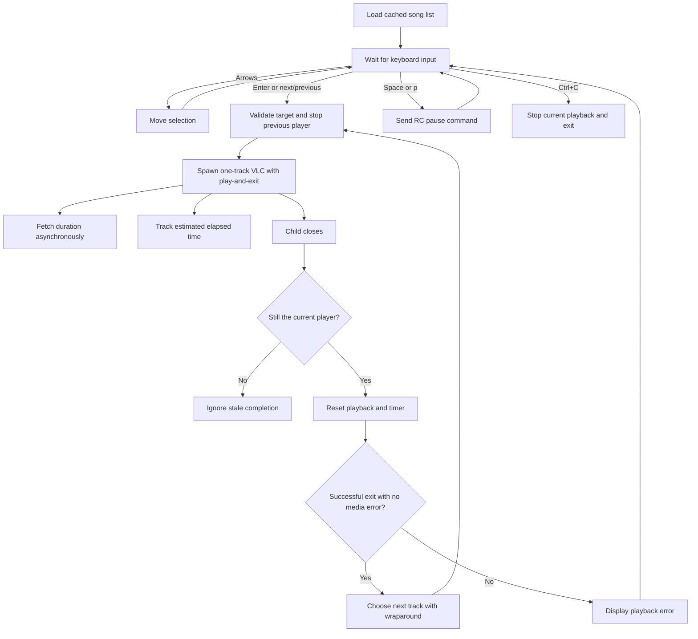

# CLI Music Player Architecture

Verified against the current implementations on **2026-11-08**. Earlier architecture reviews are available in Git history.

## Repository layout

| Path | Purpose |
| --- | --- |
| `cli_player.js` | Main interactive player: keyboard input, playlist state, VLC lifecycle, metadata, and terminal rendering. |
| `cli_player.py` | Earlier `afplay` prototype with arrow selection and Enter-to-play. |
| `songs/` | Fixed library directory adjacent to the entry points. |
| `README.md` | Setup, controls, and learning notes. |
| `ARCHITECTURE.md` | Current runtime design and review follow-up. |
| `CLI_Music_Player_Project_Report.pdf` | Historical coursework report. |
| `assets/Music_cli_player_Architecture.png` | Historical architecture illustration. |
| `prompts/history.txt` | Development-prompt history. |
| `.gitignore` | Ignore rules, including the local `BUGS.md` audit. |

`BUGS.md`, when present locally, records the original audit and follow-up status.

The main player uses Node's built-in modules. There is no package-install or build step. The root entry points stay directly runnable with `node cli_player.js` and `python3 cli_player.py`.

## Runtime responsibilities

### Executable setup

Both entry points check for macOS and validate their executables before enabling terminal raw mode. An explicit environment override takes priority and is reported as a setup error if it cannot be executed.

| Tool | Override | Default discovery order |
| --- | --- | --- |
| VLC | `VLC_PATH` | `vlc` on `PATH`, `/Applications/VLC.app/Contents/MacOS/VLC`, then the equivalent under `~/Applications`. |
| `afinfo` | `AFINFO_PATH` | `afinfo` on `PATH`, then `/usr/bin/afinfo`. |
| `afplay` | `AFPLAY_PATH` | `afplay` on `PATH`, then `/usr/bin/afplay`. |

JavaScript validates executable files with filesystem permission checks; Python uses `shutil.which`. Child processes receive an executable path and an argument array, including when paths contain spaces.

### Library and selection

`listSongs()` reads the adjacent `songs/` directory once and filters dot-prefixed entries. `cursor` is the highlighted selection; `playingIndex` identifies the playing track, or `-1` when stopped.

- Up/Down moves the selection with wraparound.
- Enter starts or restarts the selected track.
- `skipSong()` chooses next/previous relative to the playing track, falling back to the selection before playback starts.
- Starting a track, including automatic advancement, synchronizes the selection with that track.
- Empty libraries show a message and disable playback/navigation arithmetic.

There is no command-line library-path argument. Directory contents are cached, and file-type/access validation is still limited.

The Python prototype refreshes its directory listing on input, clamps the selection to the refreshed list, and skips playback requests when the list is empty. This also handles hidden-only libraries and a library becoming empty during use.

### Playback ownership

`playSong()` validates its target, calls `stopPlayback()`, updates selection/state, and starts one VLC child for that track. `stopPlayback()` invalidates the current process reference **before** killing the old child, clears the timer, and resets playback state.

Each callback captures its own `currentProcess`. Completion, process errors, input-stream errors, and metadata results may change shared state only while that process still owns playback. This prevents a late callback from an old song from stopping or advancing a replacement.

### Automatic next-track playback

The Node application owns playlist order and wraparound. Each VLC process receives:

- `--intf rc` for stdin commands such as `pause`.
- `--play-and-exit` so completing its one-track playlist terminates the process.
- `--no-loop`, `--no-repeat`, and `--no-random` to keep playlist sequencing under Node's control.
- `--no-play-and-stop`, `--no-play-and-pause`, and `--no-start-paused` to prevent saved playback preferences from stalling a track or its completion.
- Non-quiet, uncolored diagnostic output at verbosity zero for media-error detection.

On the active child's `close` event:

1. Clear the closed process reference and reset tracking.
2. For exit code zero, no terminating signal, and no recognized media failure, start `(completedIndex + 1) % allSongs.length`.
3. Otherwise display a playback error and wait for another user selection.

The last track wraps to the first; a one-track library repeats that track. Timer estimates and `afinfo` duration do not decide when a track ends.

**Why the old review's recommendation was insufficient:** Default VLC RC mode stays alive after audio finishes. A process-close listener alone cannot detect that endpoint. Explicit one-track exit behavior makes the listener useful.

### Child-process streams and errors

| Child | stdin | stdout | stderr |
| --- | --- | --- | --- |
| VLC | Pipe for RC pause commands. | Ignored. | Continuously consumed; a bounded diagnostic tail detects input/stream/demux/decoder/audio-output errors. |
| `afinfo` | Ignored. | Collected for duration parsing. | Ignored. |

VLC 3.0.24 can report an unreadable file and still exit with code zero. Recognized media-error diagnostics therefore block advancement, preventing an invalid single-track library from entering a retry loop. The Lua RC interface's normal `Interrupted` shutdown diagnostic is not treated as a media failure. This diagnostic classification is tied to VLC's log format and was verified with native playback checks.

VLC spawn, stdin-write, and stderr-read errors stop/reset the current player and produce a visible error. Synchronous spawn/write exceptions are handled as well as asynchronous process/stream errors. An `afinfo` spawn or stdout-read failure rejects the metadata lookup; the owning playback instance is stopped and the dependency error is shown. Superseded metadata errors cannot stop a replacement track.

Python catches `afplay` launch failures, clears the failed playback state, displays an error, and continues accepting input. It retains the existing player reference if stopping that player fails. Executable validation reduces setup errors, while runtime handlers cover removal or permission changes after validation.

### Metadata, progress, and rendering

`getSongDuration()` runs asynchronously after VLC has been spawned. Playback does not wait for metadata. Its result is applied only if the requesting player is still current.

`startElapsedTracking()` runs a 100 ms interval. It measures `Date.now()` differences and adds them while a player exists and the local pause flag is false. `updateProgress()` renders the current filename, elapsed/total time, and a 50-character bar once duration is available. The percentage has an upper cap of 100.

The displayed time is an estimate. VLC startup/buffering, wall-clock changes, failed/zero metadata, and terminal-size assumptions are documented follow-up areas. Metadata subprocesses also still lack cancellation and timeouts.

### Keyboard input and shutdown

The JS entry point enables raw mode for TTY stdin and handles incoming data buffers. Space or `p` writes `pause\n` to the active VLC child. Raw Ctrl+C calls `stopPlayback()` and exits.

Input-buffer decoding, JS external signal/EOF cleanup, and terminal resizing still need dedicated improvements. The Python prototype has its own simpler input loop, validates that stdin is a terminal, and restores its terminal settings on loop exit. Its playback-child cleanup still needs improvement.

## Playback flow

## Review follow-up and verification

- **B01:** Fixed by explicit end-of-track process exit and guarded automatic advancement.
- **Related lifecycle corrections:** Next/previous uses the playing index; old callbacks cannot interrupt replacements; active failures stop timing; child pipes are consumed or ignored; both players guard empty libraries and explain dependency failures.
- **Historical claims corrected:** Enter plays/restarts rather than exits; JS navigation wraps; pause uses RC commands; metadata is asynchronous; elapsed time uses measured deltas; exceeding 100% was already capped.
- **Historical artifacts:** Git history, the PDF, and the original image explain development history. This document describes the current implementation.

Development verification on **2026-11-08** passed **14 JavaScript checks** (including native VLC playback) and **8 Python checks** covering dependency validation, runtime failures, and empty/changing libraries. Native checks confirmed **A → B → A** despite conflicting VLC playback preferences, and that an unreadable track stops with an error even when VLC exits successfully.
