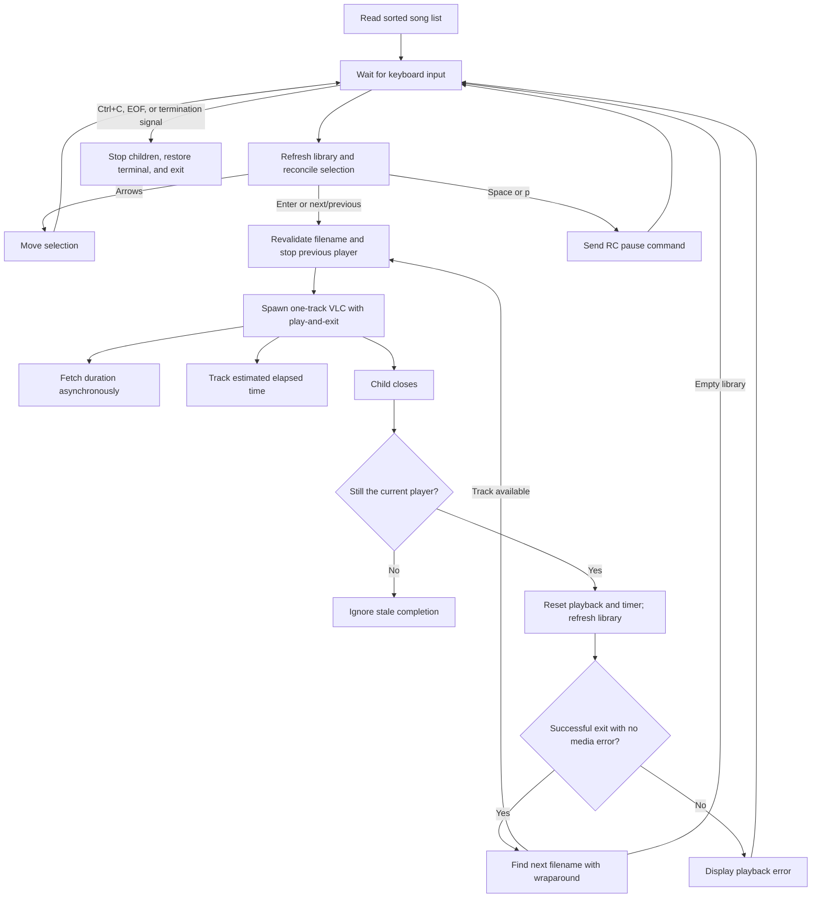

# CLI Music Player Architecture

Verified against the current implementations on **2026-11-18**. Earlier architecture reviews are available in Git history.

## Repository layout

| Path | Purpose |
| --- | --- |
| `cli_player.js` | Main interactive player: keyboard input, playlist state, VLC lifecycle, metadata, and terminal rendering. |
| `cli_player.py` | Earlier `afplay` prototype with arrow selection and Enter-to-play. |
| `tests/test_input.js` | Input-decoding regression tests using mocked streams and child processes; runnable with Node's built-in test runner. |
| `tests/test_python_input.py` | Python input-decoder checks with a deterministic clock and native pseudo-terminal regressions using fake `afplay`. |
| `tests/test_shutdown.py` | Native-process shutdown regression tests for both players, using fake audio tools and pseudo-terminals. |
| `tests/test_library.py` | Library-access regression tests, including startup validation and runtime child/terminal cleanup in both players. |
| `tests/test_media.js` | JavaScript media-filtering, playback-selection, advancement, and decoding-error regressions with mocked files and child processes. |
| `tests/test_metadata.js` | Metadata timeout, playback-status, unknown-duration, and ownership regressions, including a real hung subprocess. |
| `tests/test_progress.js` | Controlled-clock regressions for elapsed tracking, pause/resume, resets, and bounded progress rendering. |
| `tests/test_duration.js` | Full-precision duration parsing, display-only rounding, and unavailable-metadata regressions. |
| `songs/` | Fixed library directory adjacent to the entry points. |
| `README.md` | Setup, controls, and learning notes. |
| `ARCHITECTURE.md` | Current runtime design and verification. |
| `docs/ARCHITECTURAL_CHOICES.md` | In-depth engineering rationale, trade-offs, and architectural design choices. |
| `docs/PROJECT_EXPLANATION.md` | Comprehensive end-to-end project guide and code walkthrough. |
| `CLI_Music_Player_Project_Report.pdf` | Historical coursework report. |
| `assets/Music_cli_player_Architecture.png` | Historical architecture illustration. |
| `prompts/history.txt` | Development-prompt history. |
| `.gitignore` | Ignore rules, including the local `BUGS.md` audit. |

`BUGS.md`, when present locally, records open issues and limitations.

The main player uses Node's built-in modules. There is no package-install or build step. The root entry points stay directly runnable with `node cli_player.js` and `python3 cli_player.py`.

## Runtime responsibilities

### Executable setup

Both entry points check for macOS and validate their executables before enabling terminal raw mode. An explicit environment override takes priority and is reported as a setup error if it cannot be executed.

| Tool | Override | Default discovery order |
| --- | --- | --- |
| VLC | `VLC_PATH` | `vlc` on `PATH`, `/Applications/VLC.app/Contents/MacOS/VLC`, then the equivalent under `~/Applications`. |
| `afinfo` | `AFINFO_PATH` | `afinfo` on `PATH`, then `/usr/bin/afinfo`. |
| `afplay` | `AFPLAY_PATH` | `afplay` on `PATH`, then `/usr/bin/afplay`. |

JavaScript validates executable files with filesystem permission checks; Python uses `shutil.which`. Child processes receive an executable path and an argument array, including when paths contain spaces.

### Library and selection

`refreshSongs()` reads the adjacent `songs/` directory, filters entries through `isPlayableSong()`, and sorts the result. Both players require a non-hidden filename with a supported audio extension, a regular-file target, and read access. Extension checks are case-insensitive. Symlinks to readable regular files are accepted; directories, special files, broken links, and unsupported extensions are skipped. Per-entry filesystem errors, including files removed during a scan, do not abort the library refresh.

Refreshing runs at startup, before handling input or starting playback, and on active-player completion. Selection is preserved by filename, with a clamped fallback if that file disappears or becomes ineligible. `listSongs()` renders the current snapshot and clears the previous menu area.

Both players read the library before initializing the UI. Missing, non-directory, unreadable, or otherwise inaccessible paths produce a setup error naming the folder and exit with status 1 without changing the terminal. A failed refresh during use reports a library error and exits through child-process and terminal cleanup rather than exposing a filesystem traceback.

`cursor` is the highlighted selection; `playingSong` stores the active track's filename, or `undefined` when stopped. Playback identity is independent of the current directory listing.

- Up/Down moves the selection with wraparound.
- Enter starts or restarts the selected track.
- `skipSong()` chooses next/previous relative to the playing track, falling back to the selection before playback starts.
- Starting a track, including automatic advancement, synchronizes the selection with that track.
- If the active track leaves the library, it can finish playing; next/previous uses its filename's position in the refreshed sorted order.
- Empty libraries show a message and disable playback/navigation arithmetic.

There is no command-line library-path argument. The supported extension list is documented in the README. Scanning validates filenames, file type, and readability without decoding every file; a corrupt or mislabeled file with an accepted extension can still be listed, but playback failures are reported by the backend handlers rather than triggering automatic retries. Codec support depends on the backend and macOS version.

The Python prototype refreshes its directory listing before handling input and after playback completion. It preserves the selected filename when available, otherwise clamps the selection to the refreshed list, and skips playback requests when the list is empty. This also handles hidden-only libraries and a library becoming empty during use.

### Playback ownership

`playSong()` captures the requested filename and revalidates it against a fresh directory listing before calling `stopPlayback()`, updating selection/state, and starting one VLC child for that track. Every VLC and `afinfo` child is added to an owned-process registry until its `close` event. `stopPlayback()` invalidates the current process reference **before** killing owned children, clears the timer, and resets playback state.

Each callback captures its own `currentProcess`. Completion, process errors, input-stream errors, and metadata results may change shared state only while that process still owns playback. This prevents a late callback from an old song from stopping or advancing a replacement.

### Automatic next-track playback

The Node application owns playlist order and wraparound. Each VLC process receives:

- `--intf rc` for stdin commands such as `pause`.
- `--play-and-exit` so completing its one-track playlist terminates the process.
- `--no-loop`, `--no-repeat`, and `--no-random` to keep playlist sequencing under Node's control.
- `--no-play-and-stop`, `--no-play-and-pause`, and `--no-start-paused` to prevent saved playback preferences from stalling a track or its completion.
- Non-quiet, uncolored diagnostic output at verbosity zero for media-error detection.

On the active child's `close` event:

1. Clear the closed process reference and reset tracking.
2. Refresh the library and redraw the stopped state. For exit code zero, no terminating signal, and no recognized media failure, find the completed filename's next track in the refreshed order and start it if available.
3. Otherwise display a playback error and wait for another user selection.

The last track wraps to the first; a one-track library repeats that track. If the completed filename was removed, its next surviving neighbor is used; an empty library stays stopped. Timer estimates and `afinfo` duration do not decide when a track ends.

### Child-process streams and errors

| Child | stdin | stdout | stderr |
| --- | --- | --- | --- |
| VLC | Pipe for RC pause commands. | Piped and resumed so VLC RC output does not error on write. | Continuously consumed; a bounded diagnostic tail detects input/stream/demux/decoder/audio-output errors. |
| `afinfo` | Ignored. | Collected for duration parsing. | Ignored. |

VLC 3.0.24 can report an unreadable file and still exit with code zero. Recognized media-error diagnostics therefore block advancement, preventing an invalid single-track library from entering a retry loop. The Lua RC interface's normal `Interrupted` shutdown diagnostic is not treated as a media failure. This diagnostic classification is tied to VLC's log format and was verified with native playback checks.

VLC spawn, stdin-write, and stderr-read errors stop/reset the current player and produce a visible error. Synchronous spawn/write exceptions are handled as well as asynchronous process/stream errors. An `afinfo` spawn or stdout-read failure rejects the metadata lookup; the owning playback instance is stopped and the dependency error is shown. Superseded metadata errors cannot stop a replacement track.

Python catches `afplay` launch failures, clears the failed playback state, displays an error, and continues accepting input. It retains the existing player reference if stopping that player fails. While playback is active, the input loop checks `Popen.poll()` every 100 ms: completion clears the process and track references and redraws the UI; nonzero or signalled exits also display an error. Successful completion stops until the next playback request. Executable validation reduces setup errors, while runtime handlers cover removal or permission changes after validation.

### Metadata, progress, and rendering

`getSongDuration()` runs asynchronously after VLC has been spawned. Playback does not wait for metadata. The `afinfo` child uses Node's `spawn()` timeout of five seconds with `SIGKILL`, so a hung lookup is terminated without stopping VLC. Timed-out or unsuccessful lookups leave duration unavailable. Replacement and shutdown still kill owned metadata children. Results are applied only if the requesting player is still current.

The full numeric duration before `sec` is retained for percentage calculations. Only the displayed elapsed/total seconds are rounded up with `Math.ceil()`, so an exact two-second track remains two seconds and reaches 100% at its reported endpoint.

`startElapsedTracking()` runs a 100 ms interval. It measures monotonic `performance.now()` differences, unaffected by system-clock changes, and adds them while a player exists and the local pause flag is false. `updateProgress()` renders the current filename, playing/paused state, and elapsed time independently of metadata. It redraws immediately at playback start, on pause/resume, and when metadata arrives, as well as on timer ticks and menu refreshes.

Pending duration shows `?` and `Looking up duration...`; failed, non-finite, or non-positive duration shows `?` and `Duration unavailable`. Both states clear the previous progress bar and omit the percentage. With a finite positive duration, the UI renders elapsed/total time and a 50-character bar, with the percentage clamped to 0–100 and non-finite elapsed values yielding 0%. `renderBar()` also bounds its input to a finite percentage before computing repeat counts.

The displayed time is an estimate. VLC startup/buffering and terminal-size assumptions remain documented follow-up areas.

### Keyboard input and shutdown

The JS entry point enables raw mode for TTY stdin and uses `readline.emitKeypressEvents()` to decode every key, preserving incomplete arrow sequences between data buffers. It handles both normal and application-mode arrows, accepts CR or LF as Enter, and honors Ctrl+C even during an incomplete escape sequence. Space or `p` writes `pause\n` to the active VLC child.

One idempotent application-cleanup path stops the timer, kills every owned VLC/`afinfo` child, removes input listeners, and restores the prior terminal mode. Raw Ctrl+C, stdin end/close, `SIGHUP`, `SIGINT`, `SIGQUIT`, and `SIGTERM` use this path. The process `exit` and `uncaughtExceptionMonitor` hooks provide final synchronous cleanup without suppressing Node's fatal-error reporting.

The Python prototype validates that stdin is a terminal and feeds raw input chunks into `KeyDecoder`. Normal (`ESC [ A/B`) and application-mode (`ESC O A/B`) arrows can span reads, with a 50 ms monotonic timeout between fragments. The main `select()` wait respects this deadline and the playback-polling interval, so standalone or incomplete Escape sequences expire without blocking completion updates. Enter and Ctrl+C interrupt incomplete sequences and are handled independently; unsupported escape sequences are ignored.

Terminal resizing still needs dedicated improvements. Python's `finally` path terminates and waits for `afplay`, escalates to `kill()` after a bounded timeout, and restores terminal settings. Signal handlers turn catchable termination signals into normal stack unwinding so that cleanup also runs on externally requested exits and unhandled runtime errors.

Python defers signals received during `Popen()` until the returned child and track have been recorded. This prevents shutdown from leaving a just-launched process unowned. The first signal determines the exit code; further shutdown signals cannot interrupt cleanup. Neither player can run cleanup after an uncatchable signal such as `SIGKILL`.

## Playback flow

## Verification

Development verification through **2026-11-10** includes **17 JavaScript behavioral checks** and **9 Python pseudo-terminal checks** covering changing/empty libraries, selection and playback identity, completion, runtime failures, and replacement-player ownership. Native shutdown checks additionally confirmed that JS stops VLC and pending `afinfo` jobs on raw Ctrl+C, `SIGTERM`, and stdin EOF, while Python stops `afplay` and restores the terminal on raw Ctrl+C and `SIGTERM`. Earlier native VLC checks confirmed **A → B → A** despite conflicting playback preferences, and that an unreadable track stops with an error even when VLC exits successfully.

On **2026-11-11**, `python3 -m unittest discover -s tests -v` passed **8 regression tests covering 20 native-process shutdown scenarios**. Coverage includes raw Ctrl+C, all four catchable shutdown signals, fatal runtime errors, JS stdin EOF and explicit process exit, Python kill escalation, repeated shutdown signals, and signals delivered between launching a Python child and recording ownership. Tests check that playback and pending metadata processes stop and that terminal settings are restored.

On **2026-11-12**, `node --test tests/test_input.js` passed **19 input-decoding tests** covering batched commands, arrows fragmented at every byte boundary, application-mode arrows, pause shortcuts, unsupported/modified keys, Ctrl+C after other keys or during incomplete escape sequences, empty libraries, and newline Enter. The native suite passed **10 tests covering 23 shutdown scenarios**, adding batched Ctrl+C and newline-based playback followed by stdin EOF. `node --check cli_player.js` also passed.

On **2026-11-13**, `python3 -m unittest discover -s tests -p 'test_library.py' -v` passed **8 tests covering 22 native-process scenarios** and Python scanner checks. Missing, non-directory, and unreadable folders fail before UI initialization; input and completion refresh failures stop owned children and restore terminal settings. Readable empty and hidden-only libraries continue to work. JavaScript and Python syntax checks also passed.

On **2026-11-14**, `python3 -m unittest discover -s tests -v` passed **26 tests**, including **18 Python input regressions**. Deterministic decoder checks and pseudo-terminal scenarios cover standalone/expired Escape, Enter and Ctrl+C during incomplete sequences, batched keys, fragmented normal/application-mode arrows, empty libraries, playback-completion polling, child termination, and terminal restoration.

On **2026-11-15**, the missing `tests/test_library.py` suite was added to the repository. Its **8 tests** cover **22 native-process scenarios** and Python scanner checks; all six startup-error scenarios fail against the pre-fix revision. The full Python suite passes **34 tests**, and `node --check cli_player.js` passes. No additional runtime changes were needed for library-access error handling.

Later on **2026-11-15**, media eligibility filtering was added to both players for B12. The library suite passes **16 tests covering 30 native-process scenarios** and Python scanner checks, and `node --test tests/test_media.js` passes **10 JavaScript regressions**. The full Python suite passes **42 tests**. Coverage includes mixed and invalid-only libraries, case-insensitive extensions, readable file symlinks, broken/directory links, special files, unreadable entries, scan races, changing file types, safe advancement, and decoding failures without automatic retry. Syntax and whitespace checks also pass.

On **2026-11-16**, metadata deadlines and metadata-independent status rendering were added for B18. `tests/test_metadata.js` passes **13 regressions**, including a real subprocess that ignores `SIGTERM` and is killed after five seconds while playback remains active. Coverage includes pending/known/unavailable duration, immediate pause/resume status, stale results/errors, track completion, and shutdown. The unknown-duration guard also resolves B14's division-by-zero display. All **23 JavaScript tests** and **42 Python/native tests** pass, along with JavaScript syntax checks. The Python suite used a canonical `/private/var/...` `TMPDIR` to avoid the existing library tests' macOS temporary-path alias mismatch.

On **2026-11-17**, B16 was fixed with monotonic elapsed timing and finite progress bounds. All **6 progress regressions** pass, covering backward/forward wall-clock jumps, delayed ticks, pause/resume, tracking resets, inactive playback, and invalid progress inputs. The backward-clock test reproduces `RangeError` against the pre-fix code. All **26 currently available Python/native tests** and JavaScript syntax checks also pass.

On **2026-11-18**, B15 was fixed by retaining full duration precision and rounding only for display. All **5 duration regressions** and **26 currently available Python/native tests** pass, along with JavaScript syntax and whitespace checks. The exact-integer regression returns three seconds instead of two against the pre-fix parser. Real VLC audio playback was not exercised.
