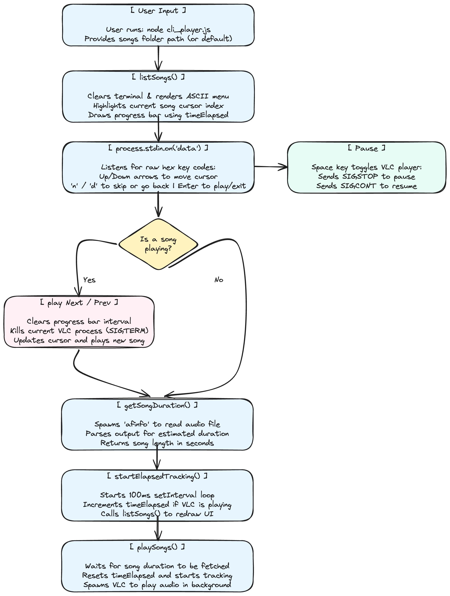

# CLI Music Player Refinement

An interactive macOS music player built with Node.js and VLC.

## Run the Player

Requirements: macOS, Node.js 22 or later, and VLC. Duration lookup uses macOS's `afinfo` command. The JavaScript code uses built-in Node modules.

The player looks for `vlc` on `PATH`, then in `/Applications/VLC.app` and `~/Applications/VLC.app`. `afinfo` is found on `PATH` or at `/usr/bin/afinfo`. Set `VLC_PATH` or `AFINFO_PATH` to use a different executable:

```sh
VLC_PATH="/path/to/VLC.app/Contents/MacOS/VLC" node cli_player.js
```

An explicit override must name an executable file or a command on `PATH`. Dependency and platform checks run before terminal raw mode is enabled; setup errors explain which executable to configure.

Place audio files in the repository's `songs/` folder, then run:

```sh
node cli_player.js
```

The library path is fixed relative to the script. Tracks automatically advance on completion and wrap from the last song to the first. An empty or hidden-only library displays a message and ignores playback/navigation requests.

Both entry points require `songs/` to exist, be a directory, and be readable. Library setup errors report the path before clearing the screen or enabling raw mode. If the folder becomes unavailable during use, the player reports a library error, stops its child processes, restores the terminal, and exits with status 1.

The sorted song list refreshes on input and track completion. Selection follows the same filename when available, otherwise it moves to a valid entry. Playback keeps its track identity even if that file is removed from the library; skipping and automatic advancement use the refreshed order.

| Key | Action |
| --- | --- |
| Up / Down | Browse the song list with wraparound. |
| Enter | Play or restart the selected track. |
| `n` | Play the next track relative to current playback. |
| `b` / `d` | Play the previous track relative to current playback. |
| Space / `p` | Pause or resume. |
| Ctrl+C | Stop all child processes, restore the terminal, and exit. |

Input decoding handles batched keys and arrow sequences split across stdin chunks. Piped input also accepts a newline as Enter.

Playback failures stop the current track and display an error; select another song with the controls above. Progress is a timer-based estimate.

### Python Prototype

`python3 cli_player.py` runs the earlier `afplay` prototype. It supports clamped arrow navigation and Enter-to-play; pause, skip shortcuts, progress tracking, and automatic advancement belong to the JavaScript player. It stops `afplay` and restores the terminal on Ctrl+C, catchable termination signals, and error exits.

The Python entry point also requires macOS and an interactive terminal. It discovers `afplay` on `PATH` or at `/usr/bin/afplay`; set `AFPLAY_PATH` for a custom executable. Playback completion clears the playing status automatically, and launch/runtime failures are shown in the UI. It refreshes the library before handling input and after completion, preserving selection by filename and safely handling empty lists.

### Regression Tests

Run the input tests with Node.js 22 or later, and the native library/shutdown tests on macOS with Python 3 and Node.js:

```sh
node --test tests/test_input.js
python3 -m unittest discover -s tests -v
```

The tests use mocked streams, isolated libraries, and fake audio executables, so VLC is not required and no audio is played. They verify batched keys, fragmented arrows, newline Enter, and child termination and terminal restoration across normal, signal, error, and launch-time shutdown paths.

`tests/test_library.py` also checks missing, non-directory, and unreadable folders before startup and during input/completion refreshes, plus readable empty and hidden-only libraries.

See [ARCHITECTURE.md](ARCHITECTURE.md) for the current design, repository-root file roles, verified behavior, and known limitations. The [project PDF](CLI_Music_Player_Project_Report.pdf) and original diagram are historical development artifacts; earlier architecture reviews are available in Git history.

---

## Concepts — Terminal Interfaces & Process Management

### What I Learned
I learned how to take full control of the terminal using Node.js! By enabling `process.stdin.setRawMode(true)`, I could catch single keypresses (like arrows or spacebar) instantly without waiting for the user to hit Enter. I also got to play around with ANSI escape sequences to move the cursor around and clear lines, which made it possible to build an actual UI that redraws in place instead of just printing line after line. On top of that, I learned how to manage background processes using `child_process.spawn` so I could run VLC and `afinfo` behind the scenes to handle the actual music playing and fetch track durations.

### Important Concepts
- `process.stdin.setRawMode(true)`: Grabbing raw keypresses right away without needing Enter.
- ANSI Escape Codes: Cool string commands (like `\x1B[2J` or `\x1B[0K`) that tell the terminal to clear the screen or clear a line.
- `child_process.spawn`: Spinning up external tools asynchronously (like running `vlc` for audio and `afinfo` for duration).
- Process events & Signals: Managing background VLC and metadata processes, handling completion/errors and application shutdown, using `SIGKILL` for replacement/cleanup, and sending RC commands for pause/resume.

### How It Relates to the Project
These concepts are the core of the whole CLI music player. The raw mode and ANSI codes let me build the interactive menu that stays in one place. Meanwhile, spawning child processes handles the heavy lifting—VLC actually plays the music in the background while my Node script just acts as the remote control and UI.

### Key Takeaway
You can build really cool, fully interactive terminal apps in Node.js just by combining raw input, ANSI codes, and managing background processes correctly.

---

## Implementation — Building a CLI Music Player

### Objective
To build an interactive CLI music player that reads songs from a folder and gives you full control over playback right from the terminal.

### What I Implemented
- Up/Down arrow navigation with wraparound at the ends of the list.
- In-place UI rendering so the menu stays put (no spamming new lines).
- Enter starts or restarts the selected song, replacing the current playback process.
- Spacebar to pause and resume the music natively.
- Next (`n`) and Previous (`b` / `d`) track controls relative to the playing song.
- Automatic next-track playback with playlist wraparound, using VLC's `--play-and-exit` behavior.
- A progress bar showing estimated elapsed time against the duration reported by `afinfo`.
- Centralized child-process, timer, and terminal cleanup when changing tracks or exiting through Ctrl+C, stdin closure, signals, or fatal errors, with ownership checks for late process events.

### Concepts Used
- `fs.readdirSync` to quickly grab all the songs from the local folder.
- `spawn` with the macOS VLC executable, `--intf rc`, and `--play-and-exit` for playback.
- `spawn('afinfo')` to fetch the total duration of the track.
- `setInterval` to keep track of elapsed time and update the progress bar smoothly.

### Project Connection
This brings together file-system reads, terminal rendering, playback controls, and asynchronous process management. The current architecture documentation records the remaining edge cases and limitations.

### Key Takeaway
State management is important: `cursor`, `playingSong`, `isPaused`, `totalDuration`, `timeElapsed`, and `trackingInterval` keep the UI coordinated with the current playback process. Exact audio-position synchronization would require querying VLC instead of estimating elapsed time.

---

## Questionnaire

1. **The first arrow-navigation version printed the song list again and again. Why did that happen, and how did you make the list redraw in the same place?**
   At first, standard `process.stdout.write()` was just pushing new text to the bottom of the terminal, so every update printed a whole new list. To fix this and make it redraw in place, I used ANSI escape sequences. Specifically, `\x1B[2;1H` to move the cursor back to the top of the menu, and `\r\x1B[0K` before printing each line to completely clear the old text on that line before drawing the new one.

2. **Why do we need both cursor movement and line clearing while redrawing the terminal UI? What problem can happen if you only move the cursor?**
   If you just move the cursor back up and write over the old text, you get this weird "ghosting" effect. For example, if the previous song name was really long and the new one is short, the leftover letters from the long name will still be visible at the end of the line. Clearing the line first makes sure we have a blank slate before drawing the new frame.

3. **What does the selected-song variable represent, and how does navigation stay within the list?**
   `cursor` identifies the highlighted entry in `allSongs`, while `playingSong` stores the playing track's filename independently of its list position. JS navigation wraps between the first and last entries; Python navigation clamps at the ends. Both players preserve selection by filename during refresh, clamp it when that file disappears, and guard empty lists.

4. **Why was afplay + SIGSTOP/SIGCONT not a reliable solution for a real pause/resume feature? What changed in the final approach?**
   Freezing a process with `SIGSTOP` suspends the entire backend rather than asking it to pause media playback. The JS player uses VLC's Remote Control interface (`--intf rc`) and writes `pause\n` to stdin to toggle pause/resume. Elapsed time is still estimated locally.

5. **How would you prove that the pause/resume implementation is correct? Describe a small test you would perform.**
   I'd start playing a 10-second song and wait exactly 3 seconds, then hit spacebar to pause. I'd wait 5 seconds in real-time, then hit spacebar again to resume. If it's correct, the audio will pick up exactly where it left off at 3 seconds, and the progress bar won't have moved at all during those 5 seconds it was paused. It should finish playing exactly 7 seconds after I resumed it.

6. **How is the progress percentage calculated? What should happen to the progress value while the song is paused?**
   The calculation is `(timeElapsed / totalDuration) * 100`, capped at 100. `afinfo` supplies the duration asynchronously. Every 100ms, the timer measures a `Date.now()` delta and adds it only while a playback process exists and `isPaused` is false. While paused, elapsed time stays fixed. Unknown/zero durations and backward clock changes still need better handling.

7. **When the user starts a new song while another song is already playing, what needs to be stopped or cleaned up? What could happen if you do not do this?**
   `stopPlayback()` first invalidates the old player reference, clears the timer, resets playback state, and sends the old player `SIGKILL`. Completion and error callbacks check ownership before acting, so queued events from a replaced process cannot skip or interrupt the new song.

8. **Describe one bug or unexpected behaviour you faced while refining this application. What did you initially think was wrong, how did you investigate it, and what was the actual fix?**
   When I implemented the progress bar, I noticed multiple intervals were running at the same time and making the timer count way too fast. I initially thought the interval delay was too small, but after looking at how I was calling `startElapsedTracking()`, I realized I wasn't clearing the old interval when a new song was played. The fix was adding a simple `if (trackingInterval) clearInterval(trackingInterval);` right before starting the new one.

9. **If you had to add "jump forward 10 seconds" next, which part of the current application would change and what existing playback information would you reuse?**
   I would capture a new keypress (like the right arrow). Since we're using VLC's `rc` interface, I'd send a seek command like `seek +10\n` directly to `player.stdin`. Then, I'd just need to manually add `10` to my `timeElapsed` variable so that the JS progress bar visually jumps forward and stays perfectly in sync with the audio.

---

## Architecture Documentation

### Flow Overview
The application handles terminal input, owns playlist state, starts one VLC process per track, advances on successful completion, estimates elapsed time, and redraws the terminal UI. The current flow diagram is maintained in [ARCHITECTURE.md](ARCHITECTURE.md#playback-flow).

### Historical Diagram

This original illustration records an earlier design; the current implementation is described in the architecture document above.


